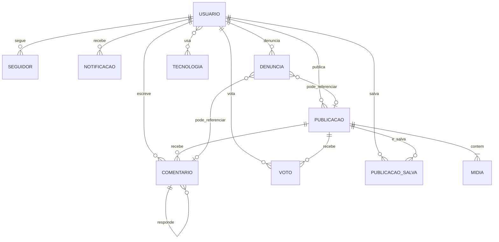

# IR — análise funcional e proposta de modelagem de dados

Data da análise: 08/11/2026  
Revisão: 1.2 — alinhamento com o back-end implementado  
Status: documento preparatório atualizado; a baseline oficial existente deve ser revisada antes de qualquer execução  
Ambientes analisados: `https://hml-ierri.eulucas.com.br/feed` e `Ierri/back-end`, branch `staging`, commit `81e15e6`  

Artefatos detalhados:

- [`entrega-modelagem-equipe.md`](./entrega-modelagem-equipe.md): handoff consolidado para revisão e aprovação da equipe.
- [`modelagem-usuarios.md`](./modelagem-usuarios.md): conta e perfil.
- [`modelagem-colecoes-sociais.md`](./modelagem-colecoes-sociais.md): demais coleções, regras e consistência.
- [`der-completo.dbml`](./der-completo.dbml): DER completo para importação no dbdiagram.io.

## 1. Resumo executivo

O IR/Ierri é uma rede de revisão de interfaces para criadores e desenvolvedores. A unidade principal do domínio é a **publicação**, composta por descrição, uma ou mais mídias e interações da comunidade. A interface atual exige persistência durável para usuários, perfis, publicações, comentários, votos, salvamentos, seguidores e notificações.

A divisão recomendada é:

- **MongoDB:** fonte de verdade dos dados de negócio, incluindo votos, pontuações e os dados necessários para reconstruir rankings.
- **Redis:** atualmente mantém sessões JWT revogáveis; futuramente também pode atender rate limit, cache, idempotência, projeção opcional de rankings e contadores de não lidas.
- **Object Storage** (S3, MinIO, Cloudinary ou equivalente): arquivos de imagem e vídeo. MongoDB guarda apenas metadados e URLs.

Redis não deve ser usado como banco permanente de posts, votos, comentários, notificações ou pontuações. O ranking oficial é calculado a partir do score persistido no MongoDB; um `Sorted Set` no Redis pode ser usado somente como projeção de leitura para melhorar desempenho. Todo o conteúdo do Redis deve ser reconstruível.

## 2. O que foi observado na aplicação

### Feed

- Feed geral (`Página Inicial`).
- Feed de pessoas seguidas (`Seguindo`).
- Feed ordenado por pontuação (`Mais votados`).
- Ranking de criadores por pontuação.
- Busca por projetos e criadores, representada no URL por `?search=`.
- Cards com autor, texto, mídia, placar, upvote, downvote e salvar.
- Atalho para criar publicação.

### Publicação

- Descrição textual.
- Galeria com uma ou várias mídias.
- Imagem e nome do autor.
- Tecnologias/stacks do autor ou projeto.
- Upvote e downvote com placar agregado.
- Placar exibido como score líquido: `upvotes - downvotes`.
- Downvotes anônimos para os usuários da plataforma.
- Salvar publicação.
- Comentários e respostas em árvore com três níveis visuais: comentário, resposta e resposta da resposta.
- Identificação visual do autor do post nos comentários.
- Contagem de comentários.

### Criação de publicação

- Campo `content` para descrever o projeto.
- Mídia obrigatória e múltipla.
- A interface aceita genericamente imagens e vídeos, inclusive HEIC/HEIF/MOV/M4V; para o MVP, a política aprovada será mais restritiva e adequada à web.
- Limite de 10 arquivos por publicação.
- Ações de cancelar e publicar.
- Visibilidade apresentada como pública.

### Autenticação

- Entrada ou criação de conta em um único fluxo.
- O back-end implementa fluxo em duas etapas: verificar e-mail e depois efetuar cadastro ou login com senha.
- Cadastro recebe `name`, `email` e `password`; login recebe `email` e `password`.
- Senhas são armazenadas como hash bcrypt com custo 12 e nunca retornadas pela API.
- Google, GitHub, Vercel e código por e-mail não estão implementados e ficam fora da baseline atual.
- JWT HS256 contém `sub` e `sid`, expira em 15 minutos e depende de uma sessão ativa no Redis.
- O token pode ser recebido por Bearer ou cookie `ierri_session`, com `HttpOnly`, `SameSite=Lax` e `Secure` em produção.
- Termos de Serviço e Política de Privacidade.
- O quadro inicial também prevê registro, login, JWT e sessão.

### Conta, perfil e notificações

- Perfil previsto com stacks, dados pessoais e posts.
- Perfis podem ser públicos ou privados.
- Em perfis privados, o follow depende de aprovação e as publicações são visíveis apenas para seguidores aceitos.
- Visualização e edição de perfil aparecem no wireframe, mas não estavam navegáveis sem autenticação no protótipo analisado.
- Notificações de comentário, resposta, upvote, novo seguidor, solicitação aceita e publicação com bom engajamento.
- Upvotes numerosos da mesma publicação devem ser agrupados; downvotes não geram notificação.
- Estado autenticado esperado para votar, salvar, comentar, seguir e publicar.

## 3. Estado atual do back-end e impacto na modelagem

O back-end é uma aplicação NestJS com Mongoose, Redis, JWT, bcrypt e Zod. Na branch `staging`, somente os módulos `auth` e `usuarios` estão implementados. As funcionalidades sociais permanecem como escopo futuro da modelagem.

### Persistência existente

- Banco configurado por `MONGODB_URI`; o exemplo utiliza o banco `ierri`.
- Única coleção atual: `usuarios`.
- Campos atuais: `nome`, `email`, `username`, `senha_hash`, `biografia`, `avatar_url` e `criado_em`.
- Índices únicos já criados para `email` e `username`.
- `username` é gerado automaticamente a partir do nome, com sufixo numérico em caso de colisão.
- O schema atual cria `criado_em`, mas não cria data de atualização.

### Sessão existente no Redis

```text
chave: ierri:auth:session:{sha256(sid)}
tipo: STRING
valor: usuarioId
TTL: tempo restante do JWT, no máximo 15 minutos
```

A sessão é criada com `NX`, consultada em cada requisição autenticada e removida condicionalmente no logout. Portanto, a baseline não utiliza refresh token, sessão de 7–30 dias, OTP ou estado OAuth.

### Compatibilidade obrigatória

- A modelagem deve estender `usuarios`, não criar uma coleção paralela `users`.
- Os campos persistidos seguirão a convenção em português já adotada pelo Mongoose.
- A API pode continuar expondo contratos em inglês (`name`, `bio`, `avatarUrl`, `createdAt`), realizando o mapeamento no serviço.
- Os scripts de modelagem anteriores não devem ser executados antes de serem ajustados a esta convenção.

### Riscos técnicos identificados

1. Se o MongoDB criar o usuário e o Redis falhar ao iniciar a sessão, a API retorna erro, mas a conta permanece criada. O back-end precisa devolver um erro específico ou orientar novo login, evitando que o usuário interprete o cadastro como totalmente perdido.
2. O seed atual usa senha fixa `1234`, abaixo do mínimo de oito caracteres definido no DTO. A senha de desenvolvimento deve vir de variável de ambiente ou ser substituída.
3. `POST /auth/check-email` revela se uma conta existe. Essa enumeração é uma decisão de produto/segurança do fluxo em duas etapas e deve ter rate limit.
4. Como haverá edição de perfil, o schema `usuarios` precisa passar a manter `atualizado_em`.

## 4. Modelo de domínio

> Para a visão completa e importável, use [`der-completo.dbml`](./der-completo.dbml). O diagrama Mermaid abaixo é uma visão conceitual resumida.



No MongoDB, mídias e preferências podem ser subdocumentos. As demais relações devem ficar em coleções próprias para evitar arrays ilimitados.

## 5. Coleções MongoDB

### `usuarios`

Fonte de verdade da conta e do perfil. Esta coleção já existe no back-end e deve ser evoluída sem criar uma coleção paralela.

> A especificação detalhada da entidade, incluindo baseline existente, evolução proposta, dicionário de dados, invariantes, índices, segurança e pendências, está em [`modelagem-usuarios.md`](./modelagem-usuarios.md). O arquivo [`der-completo.dbml`](./der-completo.dbml) apresenta sua visão física integrada.

```javascript
{
  _id: ObjectId,
  nome: String,
  username: String,             // normalizado em minúsculas
  email: String,                // normalizado em minúsculas
  senha_hash: String,           // select: false; bcrypt custo 12
  biografia: String | null,
  avatar_url: String | null,
  stack_ids: [ObjectId],
  visibilidade_perfil: "publico" | "privado",
  papeis: ["usuario" | "moderador" | "administrador"],
  contadores: {
    publicacoes: Number,
    seguidores: Number,
    seguindo: Number,
    score: Number
  },
  status: "ativo" | "bloqueado" | "excluido",
  email_verificado_em: Date | null,
  termos_aceitos_em: Date | null,
  versao_termos_aceita: String | null,
  criado_em: Date,
  atualizado_em: Date,
  excluido_em: Date | null
}
```

Índices:

- `{ email: 1 }`, único.
- `{ username: 1 }`, único.
- Índice textual ou Atlas Search para `nome`, `username` e `biografia`.
- `{ papeis: 1, status: 1 }` para autorização administrativa.

O DER em DBML e o schema Mongoose existente convergem nos campos básicos. A evolução recomendada acrescenta `stack_ids`, `visibilidade_perfil`, `papeis`, `contadores`, `status`, dados de aceite e datas de atualização/exclusão. `senha_hash` permanece obrigatório na baseline porque o back-end já implementa e testa autenticação por senha. Futuras identidades OAuth só devem ser modeladas quando o respectivo fluxo for aprovado e implementado.

### `tecnologias`

Catálogo controlado de stacks.

```javascript
{
  _id: ObjectId,
  nome: String,
  slug: String,
  categoria: String | null,
  icone_url: String | null,
  ativo: Boolean,
  criado_em: Date,
  atualizado_em: Date
}
```

Índice único em `{ slug: 1 }`.

### `publicacoes`

```javascript
{
  _id: ObjectId,
  slug: String,
  autor_id: ObjectId,
  conteudo: String,
  midias: [
    {
      _id: ObjectId,
      tipo: "imagem" | "video",
      url: String,
      chave_storage: String,
      mime_type: String,
      tamanho_bytes: Number,
      largura: Number | null,
      altura: Number | null,
      duracao_segundos: Number | null,
      texto_alternativo: String | null,
      ordem: Number
    }
  ],
  visibilidade: "publico" | "seguidores",
  status: "processando" | "publicada" | "arquivada" | "oculta" | "excluida",
  contadores: {
    upvotes: Number,
    downvotes: Number,
    score: Number,             // upvotes - downvotes
    comentarios: Number,
    salvamentos: Number
  },
  publicada_em: Date | null,
  editada_em: Date | null,
  criada_em: Date,
  atualizada_em: Date
}
```

Índices:

- `{ slug: 1 }`, único.
- `{ autor_id: 1, publicada_em: -1 }`.
- `{ status: 1, visibilidade: 1, publicada_em: -1 }` para feed geral.
- `{ status: 1, visibilidade: 1, "contadores.score": -1, publicada_em: -1 }` para mais votados.
- Índice textual/Atlas Search para `conteudo`.

Mídia fica embutida porque pertence ao post, tem quantidade limitada e é sempre lida junto. A política definida para o MVP é:

- Até 10 arquivos por publicação.
- Imagens: JPEG/JPG, PNG e WebP, com até 10 MB por arquivo.
- Vídeos: MP4/H.264 e WebM, com até 100 MB por arquivo e até 2 minutos.
- Limite agregado recomendado: 200 MB por publicação.
- HEIC, HEIF, MOV e M4V ficam fora do MVP, salvo se houver serviço de conversão para WebP/MP4.
- Validar MIME type, assinatura binária, tamanho e dimensões; não confiar apenas na extensão.
- Publicação permanece em `processando` até que todas as mídias sejam validadas.

Publicações podem ser editadas; `atualizada_em` e `editada_em` registram a última alteração. Não haverá histórico de versões no MVP. Para autor privado, a API deve forçar `visibilidade: "seguidores"`, mesmo que o cliente envie `publico`.

As tecnologias permanecem vinculadas ao perfil por `usuarios.stack_ids`, porque a interface atual as apresenta como tecnologias do criador. Tags específicas por publicação ficam como evolução posterior.

### `comentarios`

Coleção separada, pois a quantidade de comentários pode crescer sem limite. A profundidade, porém, será limitada a três níveis visuais: `profundidade: 0` para o comentário principal, `profundidade: 1` para a resposta e `profundidade: 2` para a resposta da resposta. Não será permitido criar comentário com `profundidade > 2`.

```javascript
{
  _id: ObjectId,
  publicacao_id: ObjectId,
  autor_id: ObjectId,
  comentario_pai_id: ObjectId | null,
  comentario_raiz_id: ObjectId | null,
  profundidade: Number,
  conteudo: String,
  status: "publicado" | "excluido" | "oculto",
  editado_em: Date | null,
  criado_em: Date,
  atualizado_em: Date
}
```

Índices:

- `{ publicacao_id: 1, comentario_pai_id: 1, criado_em: 1 }`.
- `{ comentario_raiz_id: 1, criado_em: 1 }`.
- `{ autor_id: 1, criado_em: -1 }`.

Ao excluir um comentário com respostas, prefira exclusão lógica e exiba “comentário removido”, preservando a árvore. Comentários podem ser editados, atualizando `atualizado_em` e `editado_em`, sem histórico de versões no MVP.

### `votos`

```javascript
{
  _id: ObjectId,
  publicacao_id: ObjectId,
  usuario_id: ObjectId,
  valor: 1 | -1,
  criado_em: Date,
  atualizado_em: Date
}
```

Índice único obrigatório em `{ publicacao_id: 1, usuario_id: 1 }`. Ele garante um voto por usuário e publicação. Trocar de upvote para downvote atualiza o mesmo documento.

O score oficial é `upvotes - downvotes` e fica persistido em `publicacoes.contadores.score`. A relação em `votos` mantém a identidade do votante apenas para integridade e prevenção de duplicidade; essa identidade não pode ser exposta em telas, APIs públicas ou notificações de downvote.

### `publicacoes_salvas`

```javascript
{
  _id: ObjectId,
  usuario_id: ObjectId,
  publicacao_id: ObjectId,
  criado_em: Date
}
```

Índice único em `{ usuario_id: 1, publicacao_id: 1 }` e índice `{ usuario_id: 1, criado_em: -1 }`.

### `seguidores`

```javascript
{
  _id: ObjectId,
  seguidor_id: ObjectId,
  seguido_id: ObjectId,
  status: "pendente" | "aceito",
  solicitado_em: Date,
  aceito_em: Date | null,
  atualizado_em: Date
}
```

Índice único em `{ seguidor_id: 1, seguido_id: 1 }`. A API deve rejeitar quando os dois IDs forem iguais. Para perfis públicos, o vínculo pode nascer como `aceito`; para perfis privados, nasce como `pendente`. Ao recusar a solicitação, o documento é removido. Apenas vínculos `aceito` contam como seguidores e concedem acesso às publicações privadas.

### `notificacoes`

Notificações precisam de persistência; o usuário deve encontrá-las mesmo se estiver desconectado quando o evento ocorrer.

```javascript
{
  _id: ObjectId,
  destinatario_id: ObjectId,
  ator_id: ObjectId | null,
  atores_preview_ids: [ObjectId],
  quantidade_atores: Number,
  tipo: "post_commented" | "comment_replied" | "post_upvoted" |
        "follow_requested" | "user_followed" | "follow_accepted" |
        "post_trending",
  entidade_tipo: "publicacao" | "comentario" | "usuario",
  entidade_id: ObjectId,
  publicacao_id: ObjectId | null,
  chave_agrupamento: String | null,
  metadados: Object,
  lida_em: Date | null,
  criada_em: Date,
  ultimo_evento_em: Date
}
```

Índices:

- `{ destinatario_id: 1, criada_em: -1 }`.
- `{ destinatario_id: 1, lida_em: 1, criada_em: -1 }`.

Regras recomendadas:

- Upvotes da mesma publicação são agrupados por `chave_agrupamento`, preferencialmente em janela de uma hora.
- `atores_preview_ids` mantém apenas poucos usuários para exibição; `quantidade_atores` registra o total do grupo.
- Comentários e respostas permanecem como notificações individuais.
- Downvotes são anônimos e não geram notificação.
- `post_trending` usa marcos configuráveis de score, por exemplo 10, 50, 100, 500 e 1.000, sem repetir o mesmo marco. O destinatário exato ainda precisa ser confirmado: somente o autor ou também seguidores potencialmente interessados.

### `denuncias`

Coleção mínima de moderação para denúncias de conteúdo ou comportamento inadequado.

```javascript
{
  _id: ObjectId,
  denunciante_id: ObjectId,
  alvo_tipo: "publicacao" | "comentario" | "usuario",
  alvo_id: ObjectId,
  motivo: "spam" | "assedio" | "inapropriado" | "direitos_autorais" | "outro",
  descricao: String | null,
  status: "aberta" | "em_analise" | "resolvida" | "descartada",
  moderador_id: ObjectId | null,
  nota_resolucao: String | null,
  criada_em: Date,
  resolvida_em: Date | null
}
```

Índices recomendados: `{ status: 1, criada_em: 1 }`, `{ alvo_tipo: 1, alvo_id: 1 }` e `{ denunciante_id: 1, criada_em: -1 }`. A moderação do MVP compreende denúncia, análise administrativa, ocultação lógica e rate limit contra spam; não exige moderação automática por inteligência artificial.

### `eventos_outbox` (recomendado)

Evita perder atualização de Redis ou notificação depois que o MongoDB já confirmou a operação.

```javascript
{
  _id: ObjectId,
  tipo: String,
  agregado_tipo: String,
  agregado_id: ObjectId,
  payload: Object,
  status: "pendente" | "processado" | "falhou",
  tentativas: Number,
  criado_em: Date,
  processado_em: Date | null
}
```

Criar o evento na mesma transação do voto, comentário ou follow. Um worker processa ranking, cache e notificações de forma idempotente.

## 6. Responsabilidades do Redis

### Sessão e autenticação temporária

| Chave | Tipo | TTL sugerido | Uso |
|---|---|---:|---|
| `ierri:auth:session:{sha256(sid)}` | STRING | tempo restante do JWT, até 15 min | valor atual: `usuarioId` |

Essa estrutura já está implementada. O JWT contém `sub` e `sid`; o `sid` é transformado em SHA-256 antes de compor a chave. A sessão é criada com `NX`, consultada em toda rota protegida e removida no logout apenas se o `usuarioId` armazenado corresponder ao token. Não há refresh token na baseline atual.

OAuth, OTP e sessões longas devem ser tratados como evoluções futuras e não como requisitos da modelagem atual.

### Cache e feeds

| Chave | Tipo | TTL sugerido | Uso |
|---|---|---:|---|
| `ierri:cache:publicacao:{publicacaoId}` | STRING/JSON | 5–15 min | detalhe da publicação |
| `ierri:cache:perfil:{usuarioId}` | STRING/JSON | 10–30 min | perfil público |
| `ierri:cache:feed:global:{cursor}` | STRING/JSON | 30–120 s | página do feed geral |
| `ierri:cache:feed:seguindo:{usuarioId}:{cursor}` | STRING/JSON | 30–120 s | feed personalizado |
| `ierri:rank:publicacoes:all` | ZSET opcional | reconstruível | projeção de publicações por score líquido |
| `ierri:rank:criadores:all` | ZSET opcional | reconstruível | projeção de criadores por score líquido |

O membro do ZSET é o ID e a pontuação é o score líquido persistido no MongoDB. O ranking pode ser consultado diretamente no MongoDB no MVP, usando índice sobre `contadores.score`; Redis é uma otimização opcional. Se usado, deve ser atualizado apenas depois do commit no MongoDB, preferencialmente pelo outbox, e nunca será a fonte oficial da pontuação.

### Notificações e tempo real

| Chave/canal | Tipo | Uso |
|---|---|---|
| `ierri:notif:nao-lidas:{usuarioId}` | STRING/COUNTER | total de não lidas |
| `ierri:eventos:usuario:{usuarioId}` | Pub/Sub ou Stream | aviso em tempo real para WebSocket/SSE |

Pub/Sub não substitui `notificacoes`, pois mensagens podem ser perdidas quando o consumidor está offline. Para entrega mais confiável, usar Redis Streams.

### Proteção e idempotência

| Chave | Tipo | TTL | Uso |
|---|---|---:|---|
| `ierri:rate:auth:ip:{ipHash}` | COUNTER | 15 min | limitar verificação, cadastro e login |
| `ierri:rate:comentario:{usuarioId}` | COUNTER | 1 min | conter spam |
| `ierri:rate:upload:{usuarioId}` | COUNTER | 1 h | limitar uploads |
| `ierri:rate:denuncia:{usuarioId}` | COUNTER | 1 h | limitar denúncias abusivas |
| `ierri:idem:{usuarioId}:{key}` | STRING | 24 h | impedir publicação/comentário duplicado |

## 7. Regras de consistência importantes

1. **Cadastro e sessão:** `usuarios` é persistido antes da sessão Redis. Se a sessão falhar, o back-end deve informar claramente que a conta foi criada e permitir novo login, evitando repetição ambígua do cadastro.
2. **Senha:** persistir somente `senha_hash`, com `select: false`; nunca retornar hash ou senha em respostas, logs ou seeds públicos.
3. **Voto:** fazer `upsert` em `votos` e ajustar `publicacoes.contadores` em transação MongoDB. O índice único impede voto duplicado.
4. **Score:** calcular `upvotes - downvotes`; a contagem pública e o ranking usam esse valor. Downvote não expõe o votante nem gera notificação.
5. **Comentário:** inserir comentário, validar `profundidade <= 2`, incrementar `publicacoes.contadores.comentarios` e gravar evento de outbox na mesma transação.
6. **Follow:** perfil público aceita imediatamente; perfil privado cria `pendente`. Contadores e acesso só consideram `aceito`.
7. **Salvamento:** índice único torna salvar idempotente; repetir a mesma requisição não duplica o registro.
8. **Upload:** rejeitar mais de 10 arquivos ou limites inválidos, criar publicação como `processando`, enviar ao object storage, validar e só então publicar. Em falha, remover arquivos órfãos por job.
9. **Privacidade:** publicações de autor privado são `seguidores`; toda consulta deve autorizar proprietário ou seguidor `aceito` antes de retornar conteúdo.
10. **Edição:** publicações e comentários atualizam `editada_em`/`editado_em` e `atualizada_em`/`atualizado_em`; o MVP não mantém histórico de versões.
11. **Exclusão/moderação:** preferir `excluido` para exclusão e `oculto` para moderação; arquivos físicos podem ser removidos após retenção.
12. **Datas:** armazenar em UTC e converter no front-end.
13. **Contadores:** são denormalizados por desempenho; criar rotina de reconciliação periódica a partir das coleções de origem.

Transações do MongoDB exigem replica set, inclusive no ambiente local. Se o projeto não usar transações, todas as operações precisam ser idempotentes e contar com reconciliação.

## 8. Consultas principais que o modelo deve suportar

- Feed público por data, com paginação por cursor.
- Feed de seguidos: obter relações `aceito` e buscar publicações desses autores.
- Mais votados por score líquido; filtros por janela podem ser adicionados depois do MVP.
- Perfil com contadores, stacks e posts recentes.
- Solicitações pendentes de follow e autorização de conteúdo de perfil privado.
- Detalhe do post com mídias, autor, voto do usuário atual e estado de salvamento.
- Comentários raiz paginados e respostas por `comentario_pai_id`.
- Posts salvos pelo usuário.
- Busca por nome/username de criador e conteúdo/tecnologia de projeto.
- Notificações paginadas e total de não lidas.

Evitar `skip` em listas grandes; usar cursor com `(publicada_em, _id)` ou `(score, _id)`.

## 9. Contrato do back-end

### Rotas já implementadas

```text
POST   /auth/check-email         { email }
POST   /auth/register            { name, email, password }
POST   /auth/login               { email, password }
POST   /auth/logout
GET    /auth/me
```

### Rotas planejadas para o domínio social

Os nomes públicos podem permanecer em inglês, independentemente da nomenclatura interna do MongoDB.

```text
GET    /users/:username
PATCH  /me/profile
POST   /users/:id/follow
DELETE /users/:id/follow
GET    /me/follow-requests
PATCH  /me/follow-requests/:id   { action: "accept" | "reject" }

GET    /posts?tab=home|following|top&cursor=&search=
POST   /posts
GET    /posts/:idOrSlug
PATCH  /posts/:id
DELETE /posts/:id
PUT    /posts/:id/vote           { value: 1 | -1 }
DELETE /posts/:id/vote
PUT    /posts/:id/saved
DELETE /posts/:id/saved

GET    /posts/:id/comments?cursor=
POST   /posts/:id/comments       { content, parentCommentId? }
PATCH  /comments/:id
DELETE /comments/:id

GET    /notifications?cursor=
PATCH  /notifications/read-all

POST   /reports                  { targetType, targetId, reason, description? }
```

OAuth, OTP, refresh token e recuperação de senha não integram o contrato implementado atual. Qualquer inclusão exige alinhamento entre produto, front-end e back-end.

## 10. Decisões consolidadas e pendências controladas

| Tema | Decisão atual | Situação |
|---|---|---|
| Comentários | Três níveis visuais; `profundidade` de 0 a 2 | Aprovada |
| Ranking | Score líquido (`upvotes - downvotes`), persistido no MongoDB | Aprovada |
| Contagem pública | Exibir o mesmo score líquido | Aprovada |
| Downvote | Anônimo e sem notificação | Aprovada |
| Privacidade | Perfil público ou privado; privado exige aprovação de follow e limita posts a seguidores | Aprovada |
| Upload | Máximo de 10 arquivos; JPEG/PNG/WebP e MP4/WebM; limites definidos na seção de publicações | Aprovada para o MVP |
| Moderação | Denúncia, análise administrativa, ocultação lógica e proteção contra spam | Escopo mínimo proposto |
| Login local | E-mail e senha com bcrypt, conforme implementação atual | **Implementado** |
| Sessão | JWT HS256 + sessão Redis revogável, TTL máximo de 15 minutos | **Implementado** |
| Cookie | `ierri_session`, HttpOnly, SameSite=Lax e Secure em produção | **Implementado** |
| Username | Gerado automaticamente a partir do nome; edição futura ainda precisa ser decidida | Parcialmente implementado |
| OAuth/OTP | Fora da baseline; avaliar apenas como evolução | Adiado |
| Notificações | Comentários, respostas, upvotes agrupados, follows e marcos de engajamento | Aprovada em nível funcional |
| Público de `post_trending` | Definir se o marco notifica somente o autor ou também seguidores | **Pendente de produto** |
| Edição | Posts e comentários editáveis, sem histórico de versões | Aprovada |
| Tecnologias | `stack_ids` no perfil no MVP; tags específicas por publicação ficam para evolução | Alinhada à interface |
| Nomenclatura MongoDB | Coleções e campos internos em português; contrato HTTP pode permanecer em inglês | Alinhada ao back-end |
| Falha Redis após cadastro | Definir resposta explícita para conta criada sem sessão | **Pendente com o back-end** |

MongoDB persiste a conta e `senha_hash`; Redis persiste apenas a sessão temporária. O fluxo de autenticação atual é e-mail + senha, não MongoDB como “provedor de login”.

## 11. Ordem recomendada de implementação

1. Corrigir a modelagem oficial para estender a coleção existente `usuarios` e remover conflitos com o Mongoose.
2. Acrescentar `atualizado_em`, privacidade, stacks, papéis, status e contadores ao schema de usuário.
3. Corrigir o seed e definir o comportamento de cadastro quando o Redis estiver indisponível.
4. Modelar e implementar `tecnologias` e o relacionamento `usuarios.stack_ids`.
5. Modelar `publicacoes` e mídias, depois implementar upload e criação de post.
6. Implementar feed e detalhe da publicação.
7. Modelar e implementar `votos`, `comentarios`, `publicacoes_salvas` e `seguidores` com idempotência.
8. Modelar e implementar `notificacoes`, `denuncias` e `eventos_outbox`.
9. Adicionar caches e ranking Redis apenas se medições demonstrarem necessidade.
10. Adicionar testes de índices únicos, concorrência de votos, privacidade, sessão e reconstrução dos dados transitórios do Redis.

## 12. Critérios de aceite do banco

- Dois usuários não podem compartilhar e-mail ou username.
- O back-end utiliza a coleção `usuarios`; nenhuma coleção paralela `users` é criada.
- `senha_hash` nunca é retornado por consultas comuns ou respostas HTTP.
- O JWT só é aceito quando a sessão `ierri:auth:session:{sha256(sid)}` correspondente está ativa.
- Logout remove a sessão e impede reutilização do JWT antes de sua expiração.
- Falha do Redis após criação da conta produz resposta explícita e recuperável para o usuário.
- Um usuário não pode votar duas vezes nem salvar/seguir duas vezes a mesma entidade.
- Trocar o voto produz os contadores corretos mesmo sob requisições concorrentes.
- Score público e ranking correspondem a `upvotes - downvotes` no MongoDB.
- APIs públicas nunca revelam quem deu downvote.
- Comentários encadeados mantêm pai, raiz e ordem e rejeitam `profundidade > 2`.
- Apagar um comentário não rompe as respostas existentes.
- Perfil privado só entrega publicações ao proprietário e a seguidores `aceito`.
- Recusar uma solicitação não incrementa contadores nem concede acesso.
- Redis pode ser apagado e reconstruído sem perda de posts, votos, comentários ou notificações.
- Logout/revogação impede a reutilização da sessão.
- Feed e comentários são paginados por cursor.
- Mais de 10 arquivos, formatos não permitidos ou mídias inválidas não tornam um post público.
- Edições atualizam as datas `editada_em`/`editado_em` e `atualizada_em`/`atualizado_em`, sem criar histórico de versões.
- Denúncias podem resultar em ocultação lógica sem destruir o conteúdo para auditoria.
- Índices principais são verificados com `explain()` e não fazem varredura total em volume representativo.
