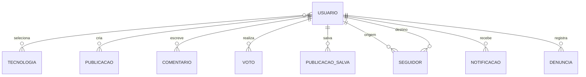

# IR / Ierri — modelagem da coleção `usuarios`

**Tipo de artefato:** especificação conceitual, lógica e física  
**Banco principal:** MongoDB  
**Status:** proposta de modelagem; não representa implementação automática  
**Escopo:** conta, perfil público e atributos de controle do usuário

**Visualização recomendada:** importar [`der-completo.dbml`](./der-completo.dbml) em [dbdiagram.io](https://dbdiagram.io). [`der-usuarios.dbml`](./der-usuarios.dbml) mantém a visão isolada desta coleção.

## 1. Objetivo

A coleção `usuarios` é a fonte de verdade da conta e do perfil. Ela identifica o autor das publicações e interações, sustenta a autenticação local já existente e concentra somente dados com cardinalidade limitada.

Publicações, comentários, votos, itens salvos, seguidores, notificações e denúncias não devem ser incorporados como arrays no usuário. Essas relações crescem sem limite e devem permanecer em coleções próprias, referenciando `usuarios._id`.

## 2. Limites da modelagem

Esta especificação está dividida em dois estados:

- **Baseline existente:** campos e índices identificados no back-end atual. Devem ser preservados para manter compatibilidade.
- **Evolução proposta:** estrutura recomendada para o domínio social. Sua adoção depende do planejamento da equipe responsável pelo back-end.

Não fazem parte desta baseline: OAuth, OTP, refresh token, dados de sessão, posts ou listas de seguidores incorporadas. A sessão atual é temporária e pertence ao Redis, não ao documento do usuário.

## 3. Modelo conceitual

Um usuário:

- possui uma conta e um perfil;
- pode selecionar zero ou várias tecnologias;
- pode criar publicações e comentários;
- pode votar, salvar publicações e denunciar conteúdo;
- pode seguir outros usuários;
- pode receber notificações.



As cardinalidades representam o domínio completo. Nesta etapa, apenas `usuarios` é detalhada fisicamente.

## 4. Modelo lógico consolidado

```javascript
{
  _id: ObjectId,

  // Identidade e autenticação — baseline existente
  nome: String,
  email: String,
  username: String,
  senha_hash: String,

  // Perfil — parcialmente existente
  biografia: String | null,
  avatar_url: String | null,
  stack_ids: [ObjectId],
  visibilidade_perfil: "publico" | "privado",

  // Autorização e ciclo de vida
  papeis: ["usuario" | "moderador" | "administrador"],
  status: "ativo" | "bloqueado" | "excluido",

  // Projeções derivadas; não são a fonte de verdade
  contadores: {
    publicacoes: Number,
    seguidores: Number,
    seguindo: Number,
    score: Number
  },

  // Verificação e aceite
  email_verificado_em: Date | null,
  termos_aceitos_em: Date | null,
  versao_termos_aceita: String | null,

  // Auditoria
  criado_em: Date,
  atualizado_em: Date,
  excluido_em: Date | null
}
```

## 5. Dicionário de dados

| Campo | Tipo | Obrigatório | Valor inicial | Regra |
|---|---|---:|---|---|
| `_id` | `ObjectId` | Sim | Gerado | Identificador imutável |
| `nome` | `String` | Sim | — | Remover espaços externos; não pode ficar vazio |
| `email` | `String` | Sim | — | Normalizado em minúsculas; formato válido; único |
| `username` | `String` | Sim | Gerado atualmente | Normalizado em minúsculas; único; sem espaços |
| `senha_hash` | `String` | Sim na baseline local | — | Dado confidencial; nunca retornar na API |
| `biografia` | `String \| null` | Não | `null` | Texto curto de apresentação |
| `avatar_url` | `String \| null` | Não | `null` | URL ou referência de leitura; não armazena o arquivo |
| `stack_ids` | `ObjectId[]` | Sim na evolução | `[]` | Referências únicas a `tecnologias`; array limitado |
| `visibilidade_perfil` | `Enum` | Sim na evolução | `publico` | Somente `publico` ou `privado` |
| `papeis` | `Enum[]` | Sim na evolução | `["usuario"]` | Valores únicos; deve conter ao menos um papel |
| `status` | `Enum` | Sim na evolução | `ativo` | Controla acesso e ciclo de vida da conta |
| `contadores.publicacoes` | `Int >= 0` | Sim na evolução | `0` | Projeção derivada de publicações válidas |
| `contadores.seguidores` | `Int >= 0` | Sim na evolução | `0` | Projeção de relações aceitas recebidas |
| `contadores.seguindo` | `Int >= 0` | Sim na evolução | `0` | Projeção de relações aceitas originadas |
| `contadores.score` | `Int` | Sim na evolução | `0` | Soma derivada do score das publicações do usuário |
| `email_verificado_em` | `Date \| null` | Não | `null` | Preenchido quando houver verificação real de e-mail |
| `termos_aceitos_em` | `Date \| null` | Não | `null` | Data do aceite aplicável |
| `versao_termos_aceita` | `String \| null` | Não | `null` | Versão associada ao aceite; deve acompanhar a data |
| `criado_em` | `Date` | Sim | Data atual | Imutável após criação |
| `atualizado_em` | `Date` | Sim na evolução | Data atual | Atualizado em alterações persistentes do documento |
| `excluido_em` | `Date \| null` | Não | `null` | Obrigatório logicamente quando `status = excluido` |

### Limites propostos que dependem de validação do produto

| Campo | Limite sugerido |
|---|---:|
| `nome` | 2 a 100 caracteres |
| `username` | 3 a 30 caracteres |
| `biografia` | Até 500 caracteres |
| `stack_ids` | Até 20 referências |
| `papeis` | Até 3 valores distintos |

Os limites acima são recomendações de modelagem, não regras já aprovadas ou implementadas.

## 6. Estados e invariantes

### Status da conta

| Status | Significado de domínio |
|---|---|
| `ativo` | Conta disponível para autenticação e uso normal |
| `bloqueado` | Conta preservada, mas impedida de autenticar ou realizar ações protegidas |
| `excluido` | Exclusão lógica; dados mínimos permanecem conforme a política de retenção |

Invariantes:

1. `email` e `username` são armazenados em minúsculas e sem espaços externos.
2. `email` e `username` não podem se repetir.
3. `stack_ids` e `papeis` não admitem duplicatas.
4. Contadores nunca podem ser negativos, exceto `contadores.score`, que pode ser negativo.
5. `status = excluido` exige `excluido_em` preenchido.
6. `status != excluido` exige `excluido_em = null`.
7. Se `termos_aceitos_em` estiver preenchido, `versao_termos_aceita` também deve estar.
8. A senha em texto puro nunca integra o documento.

## 7. Índices

### Baseline existente

```javascript
{ email: 1 }     // unique
{ username: 1 }  // unique
```

Esses índices dão suporte ao login, à verificação de e-mail e à localização do perfil. Como os valores são normalizados antes da persistência, a unicidade é efetivamente insensível a maiúsculas e minúsculas.

### Evolução proposta

```javascript
{ status: 1, criado_em: -1 }
{ papeis: 1, status: 1 }
```

- `{ status: 1, criado_em: -1 }`: listagens administrativas por situação e data.
- `{ papeis: 1, status: 1 }`: filtragem de moderadores e administradores ativos.
- Busca textual por `nome`, `username` e `biografia` deve ser decidida junto da estratégia de pesquisa: índice textual nativo ou Atlas Search. Não é necessário manter os dois.
- Não se recomenda índice isolado em `stack_ids` antes de existir uma consulta real de usuários por tecnologia.

### Política de unicidade após exclusão

Por segurança e simplicidade, a proposta mantém `email` e `username` reservados mesmo após exclusão lógica. Permitir reutilização exige uma política explícita de anonimização e índices únicos parciais; essa decisão não deve ser implícita.

## 8. Referências e decisões de incorporação

| Informação | Estratégia | Justificativa |
|---|---|---|
| Tecnologias escolhidas | Referências em `stack_ids` | Lista pequena e limitada; catálogo compartilhado |
| Contadores | Subdocumento incorporado | Leitura frequente junto do perfil; tamanho fixo |
| Papéis | Array incorporado | Poucos valores e baixa cardinalidade |
| Publicações e interações | Coleções próprias | Cardinalidade ilimitada e consultas independentes |
| Sessões | Redis | Dado temporário com expiração; já separado do MongoDB |
| Avatar | Object Storage + referência | Evita documentos grandes e armazenamento binário no perfil |

O MongoDB não oferece chave estrangeira obrigatória. Portanto, `stack_ids` precisa de validação no fluxo de negócio e de uma política para tecnologias desativadas ou removidas.

## 9. Contadores derivados

Os campos de `contadores` são projeções para leitura rápida. As fontes de verdade continuam sendo:

- `publicacoes` para a quantidade de publicações e o score;
- `seguidores` com estado aceito para seguidores e seguindo.

Atualizações concorrentes devem ser atômicas. A equipe também deve prever reconciliação periódica ou sob demanda, porque falhas entre operações podem causar divergência. Um contador não deve ser usado sozinho para provar a existência de uma relação.

## 10. Consultas suportadas

| Consulta | Campos/índice principal |
|---|---|
| Autenticar por e-mail | `{ email: 1 }` único |
| Abrir perfil por username | `{ username: 1 }` único |
| Obter usuário por identificador | `_id` padrão |
| Listar contas por status | `{ status: 1, criado_em: -1 }` |
| Localizar equipe de moderação ativa | `{ papeis: 1, status: 1 }` |
| Pesquisar criadores | Estratégia de busca ainda a definir |

## 11. Segurança e privacidade

- `senha_hash` é confidencial e deve ser excluída das consultas comuns e de toda resposta pública.
- `email`, datas de aceite e informações de status não pertencem ao perfil público.
- `papeis` só devem ser alterados por fluxo administrativo autorizado.
- Bloqueio ou exclusão da conta deve invalidar o acesso, mas a estratégia concreta de sessão pertence ao back-end.
- A exclusão lógica exige definição de retenção e anonimização antes de ser considerada conformidade com privacidade.

### Visões de leitura recomendadas

**Perfil público:** `_id`, `nome`, `username`, `biografia`, `avatar_url`, `stack_ids`, `visibilidade_perfil` e contadores públicos.

**Próprio usuário:** perfil público mais `email`, `status`, datas de verificação/aceite, `criado_em` e `atualizado_em`.

**Interna/administrativa:** campos necessários à operação, sempre sem expor `senha_hash` por padrão.

## 12. Compatibilidade e evolução

| Elemento | Situação |
|---|---|
| Coleção `usuarios` | Existente |
| `nome`, `email`, `username`, `senha_hash` | Existentes e obrigatórios |
| `biografia`, `avatar_url` | Existentes e opcionais |
| `criado_em` | Existente |
| Índices únicos de `email` e `username` | Existentes |
| Demais campos deste documento | Evolução proposta |

Não se propõe criar uma coleção paralela `users` nem renomear os campos atuais. Caso a evolução seja aprovada, documentos antigos precisarão de valores padrão ou de uma migração controlada antes de regras obrigatórias serem ativadas.

## 13. Decisões pendentes

1. O usuário poderá editar o `username`? Se sim, haverá histórico ou período de reserva?
2. Qual é a política de retenção e anonimização de contas excluídas?
3. E-mail e username poderão ser reutilizados após a exclusão definitiva?
4. Quais limites de nome, username, biografia e quantidade de stacks serão aprovados pelo produto?
5. O aceite de termos ocorre no cadastro atual ou será introduzido em etapa futura?
6. A busca de criadores usará índice textual nativo ou Atlas Search?
7. Quais campos e ações permanecem visíveis em um perfil privado?

## 14. Critérios de aceite da modelagem

- A baseline existente está distinguida da evolução proposta.
- Campos possuem tipo, obrigatoriedade, valor inicial e regra de domínio.
- Unicidade e normalização de e-mail e username estão explícitas.
- Dados ilimitados não são incorporados ao usuário.
- Contadores são identificados como projeções, com fontes de verdade definidas.
- Estados de conta e invariantes estão documentados.
- Dados públicos, privados e confidenciais estão separados.
- Pendências de produto não são apresentadas como decisões implementadas.
